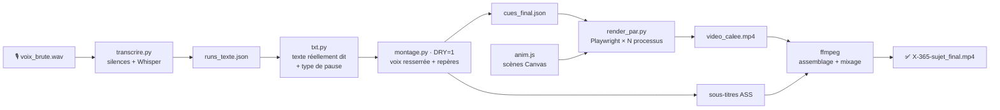

<div align="center">

# 🎬 Débrief IA Studio

**Pipeline de production automatisée de vidéos verticales et de carrousels TikTok**
pour [« Le Débrief IA »](https://www.tiktok.com/), une série quotidienne d'actualité de l'intelligence artificielle (*Jour X / 365*).


</div>

---

## En bref

Une voix off brute en entrée, une vidéo **1080×1920 prête à publier** en sortie : transcrite, resserrée, animée image par image en synchronisation avec la parole, sous-titrée et mixée, sans logiciel de montage.

Le même socle produit aussi des **carrousels photo TikTok** (benchmarks de modèles, comparatifs) qui respectent au pixel près la zone visible de l'application.

| | Vidéo « Jour X / 365 » | Carrousel photo |
|---|---|---|
| **Entrée** | Voix off (`.wav` / `.m4a`) + storyboard | Données vérifiées + graphiques capturés |
| **Sortie** | MP4 H.264 1080×1920, 30 i/s, sous-titres incrustés | 10 à 12 PNG 1080×1920 |
| **Durée de rendu** | ~1 min 30 de vidéo en quelques minutes (rendu parallèle) | Quelques secondes |
| **Point d'entrée** | `jour23_mascotte/` (modèle actuel, avec mascotte) · `jour23/` · `jour19/` | `carrousel_*/gen.py` + `_lib.py` |

## Fonctionnalités

- **Transcription locale et hors ligne** : Whisper small via [sherpa-onnx](https://github.com/k2-fsa/sherpa-onnx), sans API ni GPU, avec des outils pour lever le doute sur un mot (`fenetre.py`, `regroupe.py`, `passages.py`).
- **Montage audio automatique** : détection des silences (`ffmpeg silencedetect`), suppression des toux, ratés et prises doublées, puis resserrement des blancs selon la ponctuation (0,14 s enchaîné → 0,52 s changement de partie).
- **Animation synchronisée sur la parole** : chaque animation est calée sur le mot prononcé (`at(passage, fraction)` → `cues_final.json`).
- **Moteur d'animation Canvas 2D** déterministe (`draw(t)`) : schémas, courbes, cartes de logos, tampons, ondes de choc, glitch, écran d'abonnement.
- **Rendu headless** image par image avec Playwright/Chromium, **parallélisé** sur `cpu_count // 2` processus (120 images en ~7 s sur 4 processus).
- **Mascotte de la chaîne** : la bulle `>_` du logo devenue personnage (`mascotte.js`), bouche synchronisée sur la voix (enveloppe du signal, 30 valeurs/s) et réactions calées sur les mots forts (montre du doigt, contente, réfléchit, choquée).
- **Traitement de voix** : égalisation (passe-haut 120 Hz, creux dans le bas-médium, présence +4 dB à 3,5 kHz), compression douce et normalisation à −14 LUFS.
- **Sous-titres incrustés** au format ASS (libass) : Inter ExtraBold, mots-clés en couleur, découpage ≤ 30 caractères avec groupes protégés.
- **Bruitages synthétisés** procéduralement en NumPy (whoosh, pop, impact, riser, glitch…), sans aucun fichier sonore externe.
- **Carrousels « safe-zone aware »** : contenu contraint à la zone non recouverte par l'interface TikTok, avec un mode de contrôle `SAFE=1` qui superpose les zones masquées.
- **Skills Claude** : la méthode complète (rédaction, storyboard, style, contrôle qualité) est décrite dans `skills/` pour être rejouée par un agent IA.

## Pipeline vidéo



### Types de pause (`txt.py`)

| Type | Usage | Blanc conservé |
|:---:|---|---|
| `0` | mots enchaînés | ≤ 0,14 s |
| `1` | virgule | ≤ 0,24 s |
| `2` | fin de phrase | ≤ 0,36 s |
| `3` | changement de partie | ≤ 0,52 s |
| `4` | pause marquée (effet) | 1,45 s |
| `5` | passage coupé (toux, raté, prise doublée) | supprimé |
| `6` | la voix laisse place au son d'une capture | 4,6 s (`jour19`) |

## Structure du dépôt

```
.
├── skills/
│   ├── debrief-ia-video/SKILL.md            # méthode vidéo : script, storyboard, calage, style
│   └── carrousel-tiktok-debrief-ia/SKILL.md # méthode carrousel : structure, zone visible, DA
│
├── jour23_mascotte/         # ⭐ modèle de référence actuel : épisode Mistral + mascotte
│   ├── mascotte.js          #   personnage (3 designs, expressions, gestes)
│   ├── anim_mascotte_ep.js  #   chorégraphie de l'épisode + mise en page réduite
│   └── planche_mascotte.html #  planche de comparaison des designs
│
├── jour23/                  # épisode Mistral sans mascotte (anim_base.js + anim_ep.js)
│
├── jour13/                  # ancien modèle des vidéos quotidiennes
│   ├── index.html           #   canvas 1080×1920 + polices Inter
│   ├── anim.js              #   moteur d'animation + scènes de l'épisode
│   ├── montage.py           #   resserrement, repères, rendu, sous-titres, assemblage
│   ├── txt.py               #   texte réellement dit, passage par passage
│   ├── transcrire.py        #   silences + Whisper → runs_texte.json
│   ├── fenetre.py · regroupe.py · passages.py   # re-décodage ciblé
│   ├── render.py · render_par.py                # rendu simple / parallèle
│   └── planche.py           #   planche contact des images de contrôle
│
├── jour19/                  # épisode « battle » complet : captures d'écran + bruitages
│   ├── sfx.py               #   bruitages synthétisés en NumPy
│   ├── decoupe.py           #   découpe des passages longs aux micro-pauses
│   ├── prep_clips.py        #   extraction / recadrage de captures vidéo → frames/
│   └── anim_base.js · anim_r3.js · …
│
├── accroche.py              # écran d'accroche autonome (titre + tuiles de logos)
│
├── _lib.py                  # bibliothèque commune des carrousels (CSS, zones sûres, flèches manuscrites)
├── carrousel_kimi/          # ⭐ modèle de référence des carrousels de benchmarks
├── carrousel_gpt61terra/
├── carrousel_claude_modeles/  # carrousels construits sur _lib.py
├── carrousel_claude_skills/
│
├── _env/README.md           # polices + modèle Whisper à installer (non versionnés)
└── requirements.txt
```

> Le dépôt correspond au dossier `outils/` du projet. Les scripts utilisent des chemins relatifs (`../_env/…`, `../../assets/…`). Un dossier d'épisode doit donc rester à `outils/<episode>/`.

```
Debrief-IA/
├── assets/          # logos (non versionnés)
├── carrousels/      # PNG générés
├── outils/          # ← ce dépôt
└── *_final.mp4      # vidéos livrées
```

## Installation

**Prérequis** : Python 3.12, [FFmpeg](https://ffmpeg.org/) compilé avec libass (FFmpeg 9 conseillé), environ 1,5 Go pour le modèle Whisper.

```bash
git clone https://github.com/mart-dore/debrief-ai-studio.git outils
cd outils
python -m pip install -r requirements.txt
python -m playwright install chromium
```

Installer ensuite les polices et le modèle Whisper dans `_env/` en suivant [`_env/README.md`](_env/README.md).

> **Windows** : utiliser `python` (et non `python3`). `render_par.py` contient la garde `if __name__ == "__main__"`, indispensable au démarrage des processus en mode *spawn*. FFmpeg 9 remplace `-filter_complex_script` par `-/filter_complex`, et `montage.py` gère les deux syntaxes.

## Utilisation

### Produire une vidéo

```bash
cp -r jour23_mascotte jour24 && cd jour24
ffmpeg -i ../../voix/24-365.m4a -ac 1 -ar 48000 voix_brute.wav

python transcrire.py                  # → runs_texte.json (SEUIL=-30 DMIN=0.4 si la prise est bruitée)
python fenetre.py 3.4-5.9             # lever un doute sur un mot
# … écrire txt.py (texte réellement dit), les scènes de anim_ep.js et la chorégraphie MSEQ de anim_mascotte_ep.js
python sfx.py                         # bruitages → sfx/
cat anim_base.js anim_ep.js mascotte.js anim_mascotte_ep.js > anim.js

DRY=1 python montage.py               # voix resserrée + cues_final.json (repères + bouche de la mascotte)
python render.py ctrl/c cues_final.json 1,4.5,12
python planche.py ctrl/planche.png ctrl/c_*.png   # vérifier les images de contrôle

python montage.py                     # rendu parallèle + sous-titres + assemblage
SKIP_RENDER=1 python montage.py       # refaire seulement voix + sous-titres + assemblage
```

### Produire un carrousel

```bash
cp -r carrousel_kimi carrousel_mon-sujet && cd carrousel_mon-sujet
# déposer les graphiques c_*.png et réécrire la liste SLIDES

python gen.py                         # toutes les images → ../../carrousels/<sujet>/
python gen.py 1,12                    # seulement certaines images
SAFE=1 python gen.py                  # contrôle : zones masquées par TikTok en rouge
```

**Zone visible TikTok** (mesurée sur l'onglet « Pour toi ») : contenu entre `x = 60` et `x = 890` (jusqu'à `1020` au-dessus de `y = 860`), et entre `y = 330` et `y = 1640`.

## Charte graphique

| Rôle | Couleur |
|---|---|
| Fond (dégradé radial) | `#10111a` → `#1d1e27` |
| Accent |  `#F06E2D` |
| Modèle étudié |  `#56BCD6` |
| Mise en avant |  `#F2C94C` |
| Négatif |  `#E5484D` |
| Positif |  `#46C281` |

- **Une seule police : Inter**, jamais d'italique ni d'empattement. Seule exception : **Caveat** pour les annotations manuscrites des carrousels.
- **À l'écran, seulement ce qui est dit** : pas de titre de partie ni de phrase explicative absente de la voix off.
- **Vrais logos** uniquement, jamais de pastille à initiales.

## Skills IA

Le dossier [`skills/`](skills/) contient deux skills au format Claude Agent Skills. Ils décrivent toute la chaîne éditoriale et technique, ce qui permet à un agent de produire un épisode de bout en bout :

- [`debrief-ia-video`](skills/debrief-ia-video/SKILL.md) se déroule en deux temps : vérification des faits, script et storyboard d'abord ; voix off, puis vidéo finale en une passe ensuite.
- [`carrousel-tiktok-debrief-ia`](skills/carrousel-tiktok-debrief-ia/SKILL.md) couvre la structure intro → graphiques → verdict → abonnement, la capture haute définition des graphiques et le contrôle de la zone visible.

## Non versionné

Ne sont pas inclus dans ce dépôt : les voix off, les vidéos rendues, les logos de marques (`assets/`), les graphiques capturés depuis des sites tiers (`c_*.png`), les polices et le modèle Whisper. Voir `.gitignore`.

---

<div align="center">
<sub>Conçu et maintenu par <a href="https://github.com/mart-dore">Martin</a> · data scientist</sub>
</div>
